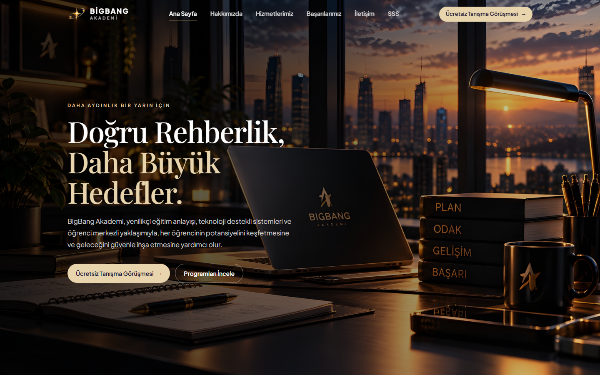

# BigBang Akademi | Educational Coaching Web Platform

**[Live Website →](https://bigbangkocluk.com/)**

## Overview

The site introduces the academy, its coaching services, student results, and contact details. It is a single-page interface with section navigation, built for desktop and mobile.

## Sections

- **Home** introduces the academy and a short preview of its services.
- **About** explains the student-focused approach and the coaching process.
- **Services** presents YKS coaching, LGS coaching, personal study planning, an AI-supported learning system, university preference consulting, one-to-one lessons, question solutions, and study-abroad planning.
- **Achievements** shows reported YKS ranking results, a success rate, and student testimonials.
- **Contact** lists the phone number, the Çukurova / Adana address, and an embedded map.
- **FAQ** answers common questions about coaching.

## Technologies

- React 19
- TypeScript
- Vite
- Tailwind CSS 4
- React Router 7
- Cloudflare Pages

## Live site

https://bigbangkocluk.com/
